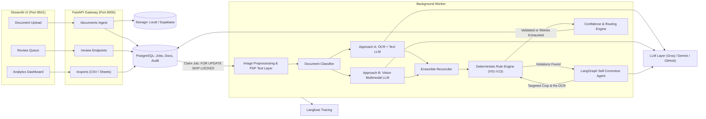

# DocFlow: Multimodal Document AI with Deterministic Arithmetic & Self-Correction

[](https://github.com/Mafnan12/DocFlow_Project/actions/workflows/ci.yml)
[](https://www.python.org/downloads/)
[](https://github.com/astral-sh/ruff)
[](https://github.com/Mafnan12/DocFlow_Project)
[](LICENSE)

> **DocFlow** is an autonomous multimodal invoice and receipt processing agent built for automated bookkeeping. It solves the critical failure of modern LLM document extractors: **silent arithmetic hallucinations**. By combining dual-approach extraction (OCR + Text LLM vs. Vision LLM), deterministic Python validation, targeted crop re-examination, and calibrated confidence routing, DocFlow ensures that auto-approved documents are guaranteed reliable.

---

## The Core Business Problem

Bookkeeping firms like **LedgerLite** manually process thousands of receipts and invoices each month. Typical LLM document demos make naive single-prompt calls, blindly trusting model outputs. In accounting, an unverified total or an off-by-one tax rate corrupts financial ledgers.

### The Real Business Metric: Auto-Approval Precision vs. Review Rate

In commercial automation, **average accuracy is a vanity metric**. If an extraction pipeline has 95% average accuracy across 10,000 documents, 500 faulty records silently enter the general ledger.

DocFlow optimizes for **Auto-Approval Precision at an Acceptable Review Rate**:
- **Auto-approved documents must achieve near-100% precision.**
- Documents with ambiguous print, arithmetic mismatches, or model disagreements are automatically routed to human reviewers with suspect fields highlighted.
- Bookkeepers review only the uncertain 10–20% of documents, drastically eliminating manual data entry while maintaining financial data integrity.

---

## System Architecture



---

## Key Engineering Innovations

| Feature | Typical Document AI Demo | DocFlow |
|---|---|---|
| **Extraction** | Single prompt, single model | **Dual independent approaches** (OCR + Text LLM & Direct Vision LLM) |
| **Arithmetic** | Trusts LLM outputs | **Deterministic Python `Decimal` engine** checking 13 financial rules |
| **Error Handling** | Blind failure pass-through | **Targeted agentic self-correction** with localized image crops |
| **Anti-Gaming Gate** | LLM alters totals to pass checks | **OCR-support gate**: new values must physically exist in crop OCR |
| **Routing** | Uniform auto-approval | **Field-level confidence scoring** tuned strictly on held-out `dev` split |
| **Job Queue** | Synchronous demo endpoints | **Production Postgres queue** with `FOR UPDATE SKIP LOCKED` |

---

## Headline Results (Test Split)

> Evaluation metrics are generated exclusively by running `evals/run_eval.py` on held-out test splits. (Rule #3: Never fabricate results).

| Experiment | Pipeline Setup | Auto-Approval Precision | Review Rate | Field F1 |
|---|---|---|---|---|
| **X1** | Approach A (OCR + Text LLM) | *Pending Benchmark* | *Pending Benchmark* | *Pending Benchmark* |
| **X2** | Approach B (Vision LLM) | *Pending Benchmark* | *Pending Benchmark* | *Pending Benchmark* |
| **X3** | Reconciled Ensemble (A + B) | *Pending Benchmark* | *Pending Benchmark* | *Pending Benchmark* |
| **X4** | Ensemble + Self-Correction Agent | *Pending Benchmark* | *Pending Benchmark* | *Pending Benchmark* |
| **X5** | Full System + Calibrated Routing | *Pending Benchmark* | *Pending Benchmark* | *Pending Benchmark* |

---

## Technology Stack ($0 Operating Cost)

- **Language & Runtime:** Python 3.11+ managed via `uv`
- **Text & Vision Models:** Groq (Llama 3.3 70B, Llama 3.2 11B Vision), Google Gemini (Gemini 1.5 Flash), GitHub Models
- **OCR Engine:** PaddleOCR & Tesseract with fallback
- **Agent Orchestration:** LangGraph (targeted crop & re-OCR cycle)
- **Database & Queue:** PostgreSQL 16 (local Docker / Supabase free tier) using row-level locking
- **Web API:** FastAPI & Pydantic v2
- **Human-in-the-Loop UI:** Streamlit multi-page interface
- **Observability:** Langfuse cloud tracing
- **Quality & CI:** Ruff, Pytest, Pre-commit, GitHub Actions

---

## Quickstart

### 1. Prerequisites
- Python 3.11+
- [uv](https://github.com/astral-sh/uv) (`pip install uv`)
- Docker & Docker Compose (optional for local Postgres)

### 2. Setup
```bash
# Clone repository
git clone https://github.com/Mafnan12/DocFlow_Project.git
cd DocFlow_Project

# Create environment and install dependencies
uv venv --python 3.11 .venv
uv pip install -e ".[dev]"

# Configure environment
cp .env.example .env

# Run database migrations
docker compose up -d postgres
uv run alembic upgrade head
```

### 3. Launch Services
```bash
# Terminal 1: API Server
uv run uvicorn docflow.api.main:app --reload --port 8000

# Terminal 2: Job Queue Worker
uv run python -m docflow.queue.worker

# Terminal 3: Bookkeeper & Admin UI
uv run streamlit run ui/Home.py --server.port 8501
```

---

## Dataset Attribution & Licenses
- **CORD v2:** Indonesian Receipt Dataset by Naver Clova (CC BY 4.0).
- **SROIE:** ICDAR 2019 Scanned Receipts Information Extraction Competition.
- **Synthetic Invoices:** Generated with Faker and Jinja2 templates with known ground-truth.

## License
MIT License. Created by [Muhammad Afnan](https://github.com/Mafnan12).
